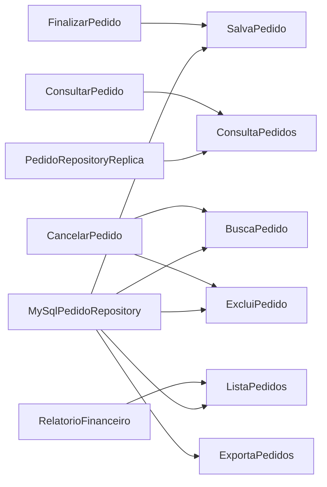

# SOLID #4 — Interface Segregation Principle (ISP)

Projeto educacional em Java que compara o mesmo domínio de pedidos em duas versões: uma com uma interface de repositório ampla (`before`) e outra com interfaces definidas para cada papel (`after`).

> “Os clientes não devem ser forçados a depender de interfaces que não utilizam.” — Robert C. Martin

## Visão geral

| Versão | Demonstração |
| --- | --- |
| `before/` | `PedidoRepository` concentra salvamento, busca, listagem, exclusão e exportação. Isso obriga clientes e implementações a depender de operações irrelevantes. |
| `after/` | Portas coesas deixam cada caso de uso declarar somente as operações que consome. Réplicas de leitura não precisam simular escrita. |

O ISP não significa criar uma interface para cada método: agrupe operações quando os mesmos clientes sempre precisam delas juntas, como busca e listagem em `ConsultaPedidos`.

## Papéis no cenário

| Consumidor | Papéis usados em `after` |
| --- | --- |
| `FinalizarPedido` | `SalvaPedido` |
| `ConsultarPedido` | `ConsultaPedidos` |
| `CancelarPedido` | `BuscaPedido` + `ExcluiPedido` |
| `RelatorioFinanceiro` | `ListaPedidos` |
| `PedidoRepositoryReplica` | `BuscaPedido` + `ListaPedidos` |

Os detalhes do princípio, da comparação e dos critérios de revisão estão em [docs/isp.md](docs/isp.md).

## Papéis e dependências



Uma implementação pode oferecer vários papéis; cada cliente de aplicação depende somente do seu contrato.

## Estrutura

```text
.
├── before/                  # Implementação que viola o ISP e testes demonstrativos
├── after/                   # Portas segregadas, casos de uso e testes unitários
├── acceptance-test/         # Testes de comportamento e arquitetura entre before/after
├── docs/
│   └── isp.md               # Explicação e requisitos do projeto
├── pom.xml                  # Parent/aggregator Maven para os três módulos
├── README.md
└── CHANGELOG.md
```

## Pré-requisitos

- JDK 21
- Maven 3.9+

## Executar

Na raiz do repositório:

```bash
mvn clean verify
```

O comando compila e executa os testes unitários de `before` e `after` e os testes de aceitação. Para compilar produção e testes sem executá-los:

```bash
mvn clean test-compile
```

No VS Code, abra a raiz do repositório e aguarde o carregamento automático dos projetos Maven. Os módulos usam o parent POM da raiz para compartilhar versão Java, plugins e dependências de teste.

## O que os testes verificam

- Comportamento correspondente nas versões `before` e `after` para finalizar, cancelar, consultar e gerar relatório.
- Fakes mínimos para cada papel no `after`.
- Tipos de dependência declarados pelos casos de uso.
- Réplica limitada a interfaces de leitura, sem operações de escrita.

## Métricas

| Métrica | `before` | `after` |
| --- | --- | --- |
| Métodos usados por `FinalizarPedido` | 1 de 5 | 1 de 1 |
| Implementações forçadas a lançar `UnsupportedOperationException` | 1 | 0 |
| Métodos no fake de `FinalizarPedido` | 5 | 1 |
| Clientes de aplicação afetados por mudança em `exportarCsv()` | Todos os 4 casos de uso | Nenhum; somente consumidores de `ExportaPedidos` |

## Documentação e referência

- [Documentação do ISP](docs/isp.md)
- [Plano original e requisitos do projeto (PDF)](<SOLID #4 – I Interface Segregation Principle (ISP) – Plano.pdf>)
- [Repositório SRP da série SOLID](https://github.com/PauloHFA/S)
- Consulte também o [CHANGELOG](CHANGELOG.md) para o histórico do projeto.
